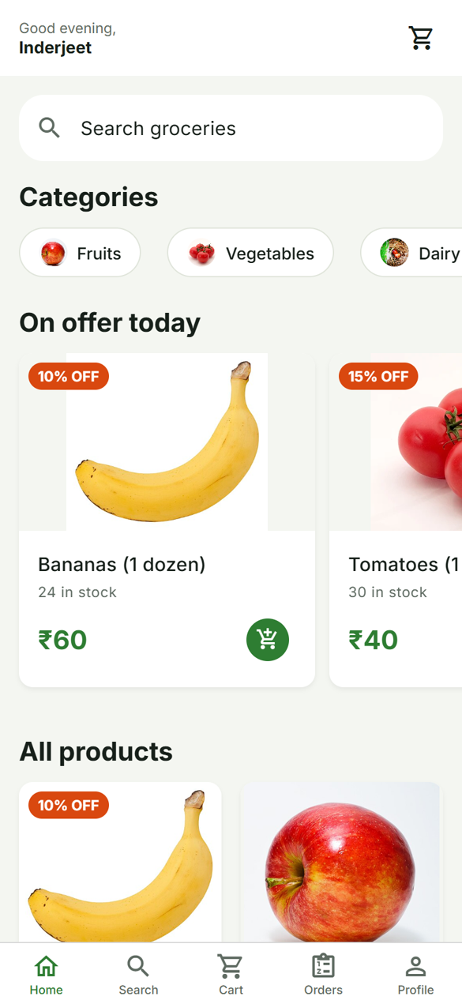
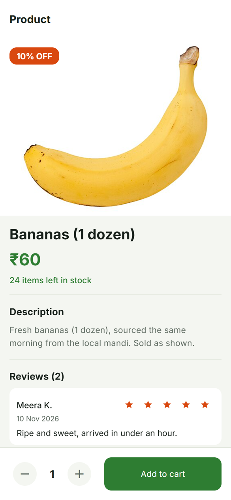
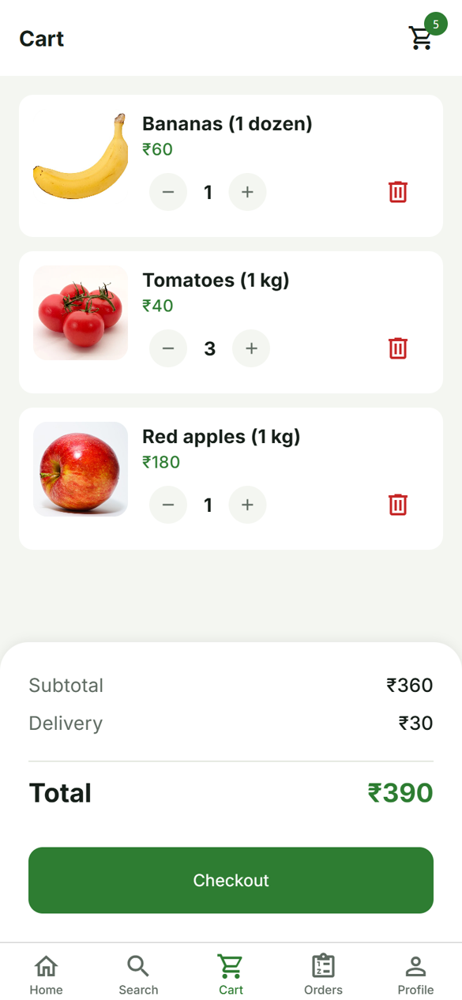
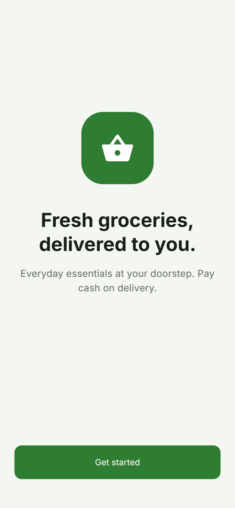
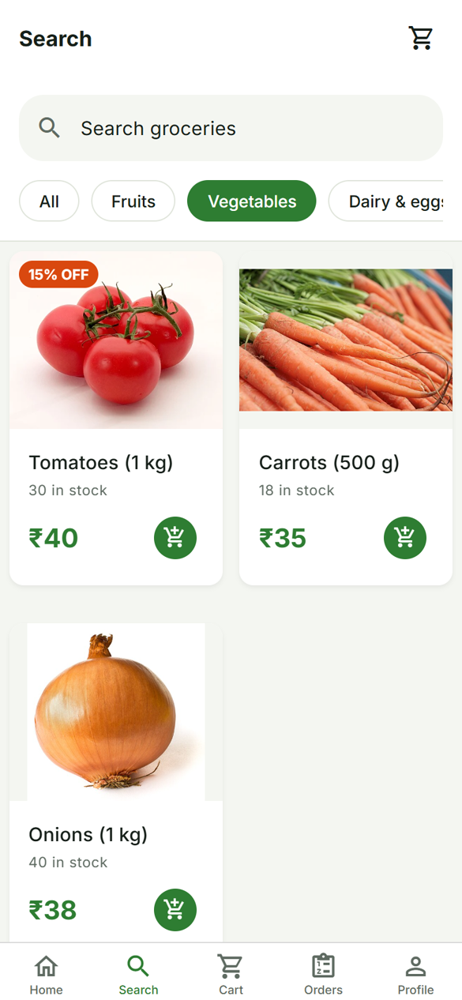
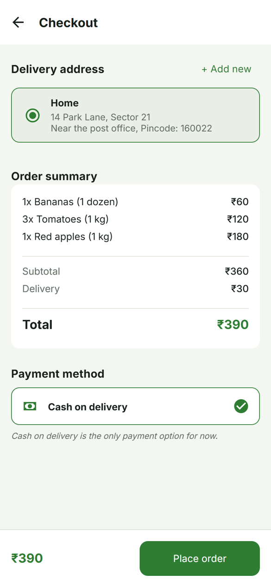
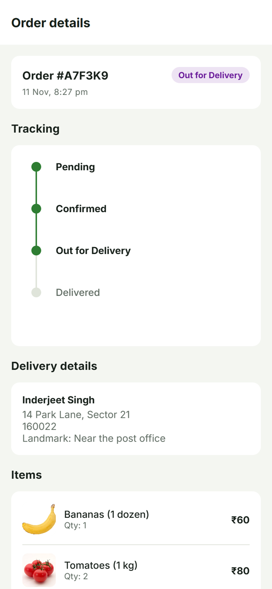
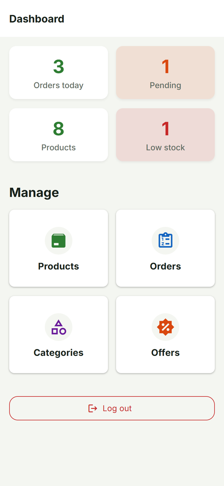
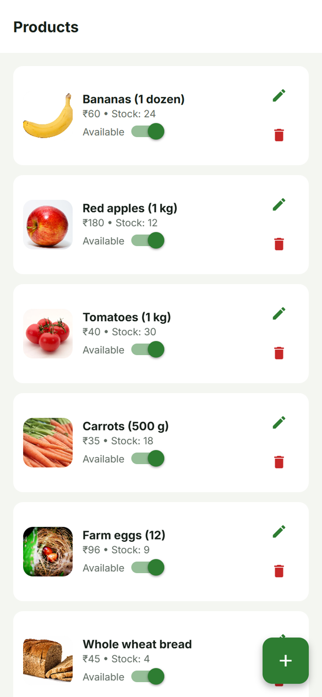
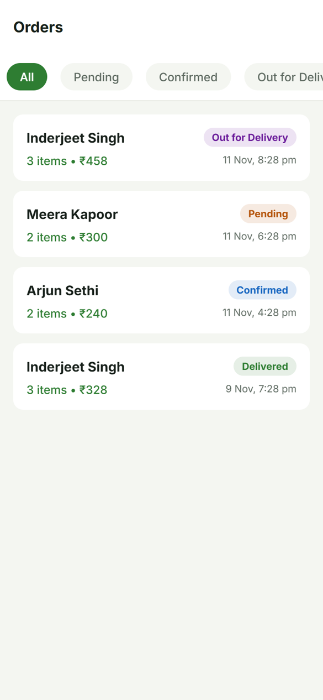

# Grocery Delivery

A cash-on-delivery grocery app for a single shop. Customers browse, fill a cart and place an order. The shop owner runs everything else from an admin panel inside the same app: stock, categories, offers and order status.

Built with Expo (React Native) and Firebase. One codebase runs on Android, iOS and the web.

<p align="center">
  
  
  
</p>

## What it does

For customers:

- Sign up with email and password, reset it by email if forgotten
- Browse by category, search by name, see what is on offer today
- Add to cart (capped at the stock that is actually left)
- Save delivery addresses and check out with cash on delivery, flat ₹30 delivery fee
- Follow an order through Pending, Confirmed, Out for Delivery and Delivered
- Get a push notification each time the status changes
- Rate the items once the order is delivered

For the shop owner:

- Dashboard with today's orders, pending orders, product count and low-stock count
- Add, edit and delete products, with photos from the phone gallery
- Manage categories and percentage offers
- Move orders through each status, and see the customer's phone number on the order

## Screens

The customer side:

| Welcome | Search | Checkout | Order tracking |
| :---: | :---: | :---: | :---: |
|  |  |  |  |

The admin side:

| Dashboard | Products | Orders |
| :---: | :---: | :---: |
|  |  |  |

These were taken from the web build at phone width, with a sample catalogue loaded. More are in [docs/screenshots](docs/screenshots).

## How it works

There is no custom backend. The app talks to Firebase directly, and `firestore.rules` decides who can do what.

```
app/            screens (expo-router, file-based)
  (auth)/       welcome, login, signup, forgot password
  (tabs)/       home, search, cart, orders, profile
  admin/        dashboard, products, categories, offers, orders
  product/[id]  product detail and reviews
  order/[id]    order tracking and rating
  checkout      address + order summary
components/     ProductCard, CategoryChip, StatusBadge, modals
services/       all Firebase calls (auth, products, orders, notifications)
store/          zustand stores (auth, cart, notifications)
constants/      colours, sizes, fonts, delivery fee
utils/          date formatting
types/          shared TypeScript types
```

### Sign-in and roles

Firebase Auth handles the email and password. On sign-up the app also writes a `users/{uid}` document holding the name, phone, addresses and a `role`, which is always `customer`. The signed-in user is kept in a zustand store persisted to AsyncStorage, so the app reopens straight to the right place: customers land on the tabs, admins on the dashboard.

There is no admin sign-up. To make someone an admin, change `role` to `admin` on their user document in the Firebase console.

### Catalogue

Products and categories are read with Firestore `onSnapshot` listeners. Nothing is polled or cached by hand. When the owner edits a price or stock runs out, every open app picks it up on its own.

### Cart and checkout

The cart lives in memory (zustand) and is cleared when the order goes through. Placing an order is one Firestore batch: it creates the order document and decrements stock on every product in it. Either all of that is written or none of it.

Payment is cash on delivery only. The delivery fee is a constant in `constants/theme.ts`.

### Order tracking and notifications

The order screen listens to its own order document, so a status change made by the admin shows up live. After changing a status, the admin's app looks up the customer's Expo push token and sends the notification through Expo's push service. Tokens are saved on the user document when the customer allows notifications.

### Security rules

`firestore.rules` is the only thing standing between a client and the database, so the important checks are there:

- anyone can read products, categories and reviews
- only admins can write products and categories
- a signed-in customer may update a product only if the one field changed is `stock`, and only downwards (this is what lets checkout decrement stock)
- customers can read and create their own orders, and may only flip `reviewed` afterwards
- admins can read and update every order

## Running it

You need Node 20 or newer and a Firebase project with Authentication (email/password), Firestore and Storage switched on.

```bash
npm install
```

Create a `.env` file in the project root with your Firebase web config:

```
EXPO_PUBLIC_FIREBASE_API_KEY=
EXPO_PUBLIC_FIREBASE_AUTH_DOMAIN=
EXPO_PUBLIC_FIREBASE_PROJECT_ID=
EXPO_PUBLIC_FIREBASE_STORAGE_BUCKET=
EXPO_PUBLIC_FIREBASE_MESSAGING_SENDER_ID=
EXPO_PUBLIC_FIREBASE_APP_ID=
```

Paste the contents of `firestore.rules` into the Firestore rules tab (or deploy with `firebase deploy --only firestore:rules`), then start the app:

```bash
npx expo start
```

Press `a` for Android, `i` for iOS or `w` for the web, or scan the QR code with Expo Go. Push notifications need a real device and a development build; they do not arrive in Expo Go on Android or on the web.

The first run shows an empty shop. Sign up, promote your account to admin in the Firebase console, log in again and add categories and products from the dashboard.

## Known limits

- Cash on delivery only, no online payment
- One shop, one flat delivery fee, no delivery slots
- The cart is not saved between app restarts
- Push notifications are sent from the admin's device. That is fine for one shop, but a busier setup should move it to a Cloud Function
- No automated tests yet

## Tech

Expo SDK 54, React Native 0.81, expo-router, React Native Paper, zustand, Firebase 12 (Auth, Firestore, Storage), expo-notifications, TypeScript.
